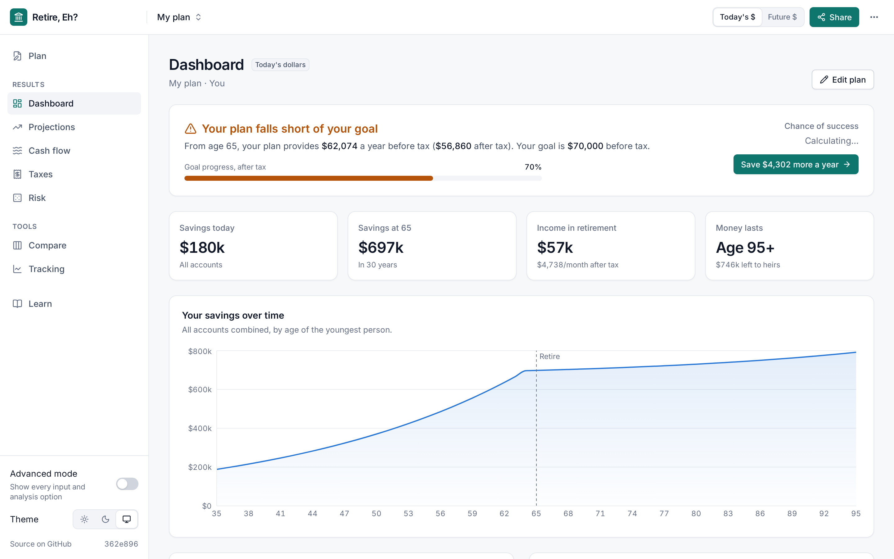

# Retire, Eh? 🍁

[](https://opensource.org/licenses/MIT)

> Plan your Canadian retirement, eh?

A household-first retirement planner for Canadians. Build an RRSP, TFSA, and CPP strategy with conservative projections and transparent math. Everything runs locally in your browser.



## Features

- **Household-first dashboard** with one verdict from a year-by-year simulation
- **Canadian-focused**: 2026 federal and provincial tax, RRSP/RRIF, TFSA, FHSA, LIRA/LIF, CPP/QPP, OAS and GIS
- **Risk**: Monte Carlo, historical replay and stress tests on the same engine
- **Proposals** that test changes against your own plan
- **Tracking** of actual balances against a saved projection
- **Private by default**: all calculations run in-browser
- **Fast & lightweight**: pure TypeScript client-side engine with zero loading delay

## Quick Start

```bash
git clone https://github.com/kombatant/retire-eh-reloaded.git
cd retire-eh-reloaded
npm install
npm run dev
```

Open http://localhost:5173 to view the app.

## Tech Stack

| Layer | Technology |
|-------|------------|
| Frontend | React + TypeScript + Tailwind CSS |
| Charts | Recharts |
| Calculations | Pure TypeScript Calculation Engine |

All financial logic runs client-side in pure TypeScript: deterministic, testable, instant, and privacy-preserving.

## Development

```bash
npm run dev        # Start dev server
npm run build      # Production build
npm run typecheck  # TypeScript check
npm run lint       # ESLint
npm test           # Vitest unit tests
```

### AI-Assisted Development

See [AGENTS.md](./AGENTS.md) for build commands and conventions.

## Design Philosophy

- **Conservative assumptions**: realistic projections over optimistic ones
- **Explicit explanations**: the math is always visible
- **Household-first approach**: savings evaluated jointly across partners

> One household balance sheet, multiple tax wrappers.

Retirement success is a household outcome. Savings get evaluated jointly regardless of who contributes, with strategic allocation between RRSP and TFSA based on marginal tax rates.

## What This Doesn't Do

- Bank account linking (stock prices are optional, fetched with your own free API key)
- FIRE or early-retirement evangelism
- Non-Canadian retirement accounts (401k, IRA, etc.)

## License

MIT. See [LICENSE](LICENSE) for details.
